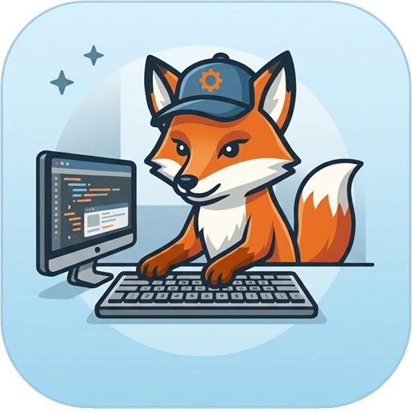
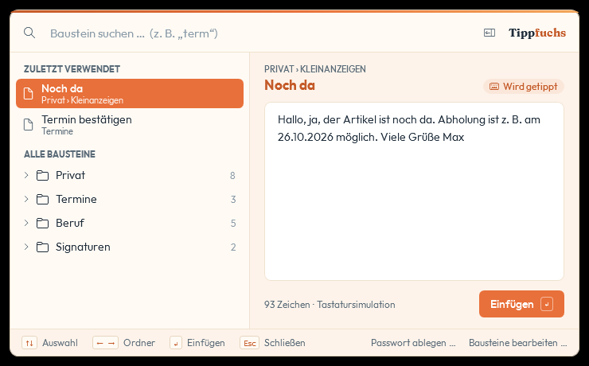
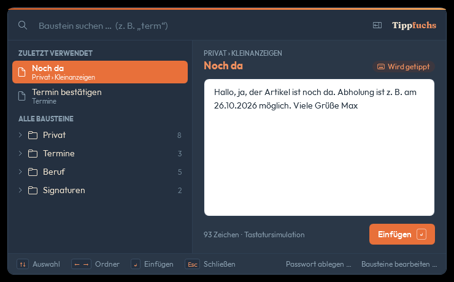
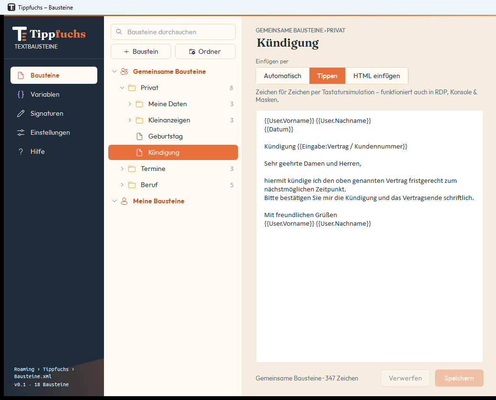

  

<h1 align="center">Tippfuchs</h1>

  <b>Textbausteine per Tastendruck – in jedes Windows-Programm.</b> 
  Kostenlos aus der <a href="https://fuchsbude.de">Fuchsbude</a>.

  <a href="https://github.com/Fuchsbude/tippfuchs-releases/releases/latest/download/Tippfuchs.exe"><b>⬇ Tippfuchs herunterladen</b></a>
  &nbsp;·&nbsp;
  <a href="https://fuchsbude.de/tippfuchs">Webseite</a>
  &nbsp;·&nbsp;
  <a href="https://github.com/Fuchsbude/tippfuchs-releases/releases">Alle Versionen</a>

---

In ein Textfeld klicken, **Strg + ↓** drücken, ein paar Buchstaben tippen, **Enter** – fertig.
Tippfuchs fügt den Baustein dort ein, wo der Cursor steht: in Outlook, Teams, im Browser, in Word
oder in einer Fernwartung.

  
  &nbsp;
  

## Funktionen

- **Popup an der Maus** mit Suche, zuletzt verwendeten Bausteinen und Vorschau
- **Platzhalter** für Datum, Name, Begrüßung, Signatur – oder Rückfragen beim Einfügen
- **Formatierte Bausteine** mit Fett, Farben, Listen, Links und Bildern
- **Editor** mit Ordnern, Ziehen & Ablegen und eigener Seite für Signaturen
- **Hell & Dunkel** – folgt Windows oder fest eingestellt

**Für Teams & IT:** gemeinsame Bausteine auf einer Netzwerkfreigabe, Benutzerwerte aus dem
Active Directory, Betrieb auf dem Terminalserver und ein **Kurzzeit-Passwort** für die Fernwartung
(z. B. aus Windows LAPS) – nur verschlüsselt im Arbeitsspeicher, nie auf der Platte.

  

## Installieren

1. [**Tippfuchs.exe herunterladen**](https://github.com/Fuchsbude/tippfuchs-releases/releases/latest/download/Tippfuchs.exe) und starten.
2. **Installieren** klicken. Tippfuchs richtet sich für dich ein – ohne Adminrechte, mit Eintrag im
   Startmenü und unter *Einstellungen → Apps*, und startet ab dann mit Windows (abschaltbar).
3. Die heruntergeladene Datei kann danach gelöscht werden.

Voraussetzung: Windows 10 (ab 1809) oder Windows 11. Alles Nötige ist in der Datei enthalten.

> **Hinweis:** Tippfuchs ist (noch) nicht mit einem kostenpflichtigen Zertifikat signiert.
> Beim ersten Start kann Windows deshalb „Der Computer wurde durch Windows geschützt“ anzeigen –
> dann auf **Weitere Informationen → Trotzdem ausführen** klicken.
> Auf manchen Windows-11-PCs ist **Smart App Control** aktiv; dort kann Windows Tippfuchs blockieren.
> Eine Version im Microsoft Store ist geplant.

**Updates:** Tippfuchs schaut einmal am Tag nach, ob es eine neue Version gibt, und fragt dich, bevor es
aktualisiert. Installiert werden nur Updates, die mit dem Schlüssel der Fuchsbude signiert sind.

**Deinstallieren:** *Einstellungen → Apps → Tippfuchs → Deinstallieren*. Deine Bausteine kannst du dabei behalten.

## Deine Daten

Tippfuchs speichert Bausteine und Einstellungen nur auf deinem PC (bzw. in der Datei, die du wählst)
und sendet nichts ins Internet. Einzige Verbindung: einmal am Tag die Frage an GitHub, ob es eine neue
Version gibt – abschaltbar unter *Einstellungen → Täglich nach Updates suchen*.

## Fragen, Ideen, Fehler?

Schreib an [kontakt@fuchsbude.de](mailto:kontakt@fuchsbude.de?subject=Tippfuchs) oder schau auf
[fuchsbude.de/tippfuchs](https://fuchsbude.de/tippfuchs).

---

© 2026 Fuchsbude. Tippfuchs ist kostenlos, der Quellcode ist nicht öffentlich.
Dieses Repository enthält nur die Downloads.
Mitgelieferte Schriften: Outfit und Fraunces (SIL Open Font License 1.1), Ubuntu Mono (Ubuntu Font Licence 1.0).
